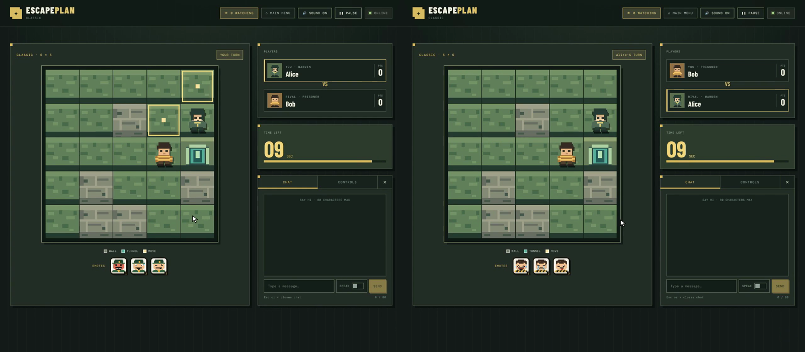
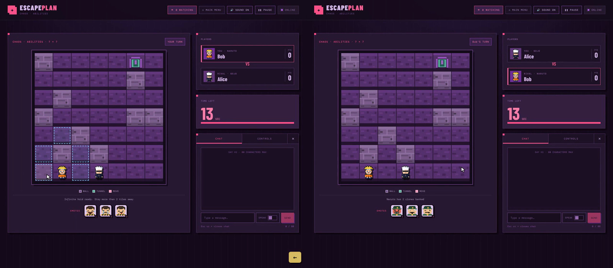
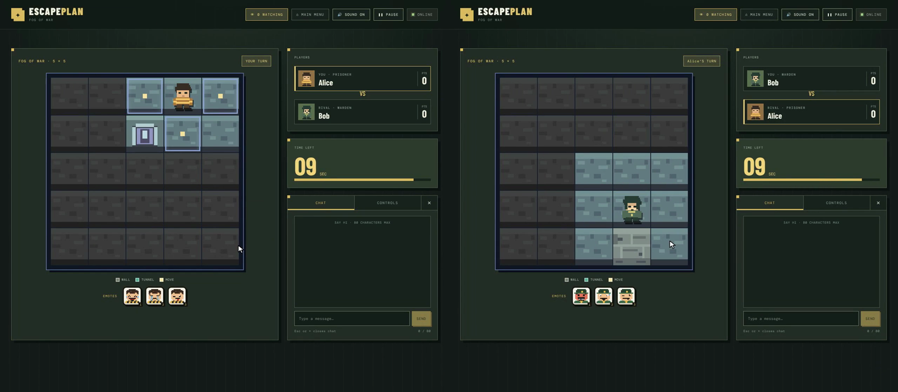
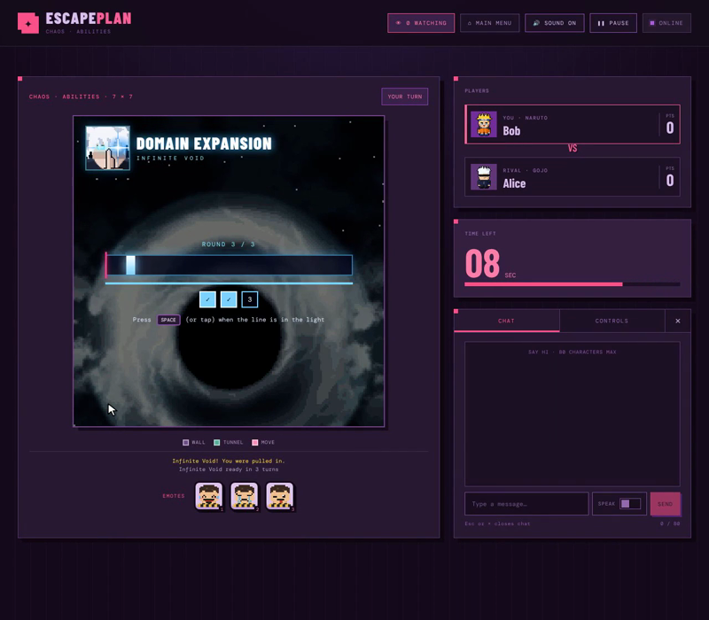
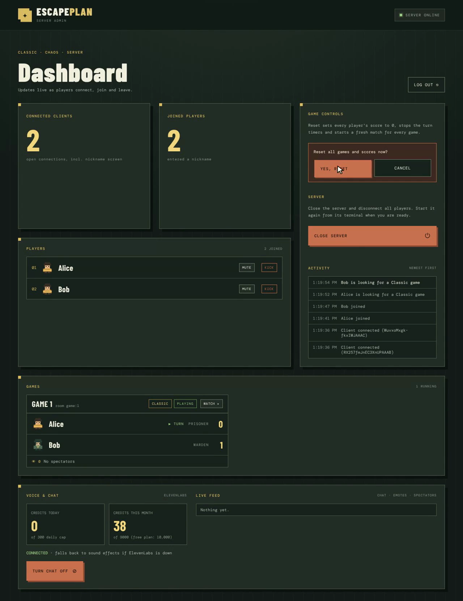

# Escape Plan

A two-player online jailbreak game, built for the Netcentric course
(Information and Communication Engineering, Year 3, Chulalongkorn University).

One player is the **warden**, the other is the **prisoner**, and there is one
**tunnel**. The prisoner wins by reaching the tunnel; the warden wins by
catching the prisoner. Players take turns on a small grid, each move is checked
by the server, and both screens update at the same time.



## Contents

- [How to play](#how-to-play)
- [Features](#features)
- [Getting started](#getting-started)
- [Configuration](#configuration)
- [Project structure](#project-structure)
- [Testing](#testing)
- [More documentation](#more-documentation)
- [Contributors](#contributors)
- [License](#license)

## How to play

1. Enter a nickname and pick a mode. The server pairs you with another player
   who picked the same mode.
2. Both players press **Ready**. Roles are random in the first match.
3. The warden moves first, then turns alternate. Move one tile up, down, left
   or right with the **arrow keys**, **WASD** or the on-screen buttons.
   Highlighted tiles show where you can go.
4. Walls block both players. Only the prisoner can enter the tunnel.
5. Each turn has a timer (10 seconds in Classic). Press **X** to **Stay** and
   skip a move, at most twice in a row (moving gives the stays back). If the
   timer runs out, the server uses a stay for you, or makes a random legal
   move when you have none left.
6. The prisoner scores a point by reaching the tunnel, the warden by catching
   the prisoner. If the same position comes up three times, the match is a draw.
7. A rematch starts when both players vote for it. The winner becomes the
   warden, and every match gets a new random map.

## Features

### Classic mode (the course requirements)

- Server on port 3000 and clients on other computers in the same network.
- Nicknames checked by the server, and a live **Online now** list of players.
- 5×5 board with 19 free tiles, 5 walls and 1 tunnel. Every map is checked
  before use: the prisoner can reach the tunnel by two separate routes, nobody
  starts next to it, and the warden starts close enough to give chase.
- 10-second turns timed by the server, so both screens show the same countdown.
- Scores, win/lose screens on both computers at once, and rematch voting.
- An admin page on the server showing connected clients, with a **Reset**
  button that ends the game and sets every score to 0.

### Extra features

| Feature | What it does |
| --- | --- |
| **Vs AI** | Play against a bot that runs on the server. It uses breadth-first search to chase you as the warden, or to head for the tunnel and keep away from you as the prisoner. |
| **AI voices** | Emotes and chat messages can be spoken aloud in each role's voice using ElevenLabs. Each line is generated once and saved. Without an API key, sound effects play instead. |
| **Chat and emotes** | Messages of up to 80 characters and three emotes per role (keys **1 2 3**). |
| **Chaos mode** | A 7×7 board with 20-second turns. Each side picks one of six classes with its own ability, such as shadow clones or Gojo's Domain Expansion timing challenge. See [docs/CHAOS_MODE.md](docs/CHAOS_MODE.md). |
| **Admin tools** | Password-protected admin page with a live activity feed, mute, chat on/off, live watching of any game, kick with a reason, and a safe server shutdown. |
| **Fog of War** | You only see the 3×3 square around you. The server removes hidden tiles before sending the map, so nobody can cheat by reading network messages. |
| **Custom maps** | The host picks the board size (5 to 20 tiles per side) and wall density (5% to 30%). Custom maps pass the same checks as Classic maps. |
| **Spectating** | While waiting for an opponent, watch live games, chat and send crowd emotes. |
| **Ready, pause and Stay** | Matches start when both players are ready, pausing needs both players to agree, and Stay lets you skip a move. |

| Chaos mode | Fog of War |
| --- | --- |
|  |  |
| **Domain Expansion** | **Admin page** |
|  |  |

## Getting started

You need [Node.js](https://nodejs.org) `^22.12.0`, `^24.0.0` or `>=26.0.0`
(as declared in `package.json`) and npm.

```sh
git clone https://github.com/BaroqueViola/escape-plan.git
cd escape-plan
npm install
cp .env.example .env   # optional: ElevenLabs key and admin password
```

### On one computer (for testing)

```sh
npm start              # terminal 1: game server and admin page on port 3000
npm run dev:client     # terminal 2: game page
```

Open the URL Vite prints (normally `http://localhost:5173`) in two browser
windows and join with two different nicknames. The admin page opens at
`http://localhost:3000/admin.html` (set `NO_OPEN=1` to stop it opening
automatically).

### On several computers (for the demo)

All computers must be on the same network. A phone hotspot works well, since
many campus and public Wi-Fi networks block devices from talking to each other.

1. On the server computer, find its IP address and put it in
   `client/src/config.ts` on **every** computer, for example
   `export const SERVER_URL = 'http://192.168.1.23:3000';`.
   Players never type an address or port in the game.
2. **Server computer:** run `npm start`. It can also be a player: run
   `npm run dev:client` in a second terminal.
3. **Each player computer:** run `npm run dev:client` and open the URL it prints.

Step-by-step instructions for macOS, Windows and Linux, including how to find
the IP address and get an ElevenLabs key, are in
[docs/TWO_COMPUTER_SETUP.md](docs/TWO_COMPUTER_SETUP.md).

> The server serves the admin page, assets and voice clips. It does not serve
> the game page itself, so every player computer runs `npm run dev:client`.

## Configuration

Settings go in a `.env` file in the project folder on the **server computer
only** (copy `.env.example`). `.env` is in `.gitignore`; never commit it.

| Variable | Default | Purpose |
| --- | --- | --- |
| `ADMIN_PASSWORD` | `admin123` | Password for the admin page. Change it before a real session. |
| `PORT` | `3000` | Server port. If you change it, also update `SERVER_URL` and the Vite proxy. |
| `NO_OPEN` | not set | Set to `1` to stop the admin page opening automatically. |
| `ELEVENLABS_API_KEY` | empty | Turns on AI voices. Without it the game uses sound effects. |
| `ELEVENLABS_VOICE_WARDEN`, `ELEVENLABS_VOICE_PRISONER` | George, Rachel | Voice IDs for each role. Free plans may need voices from your own library. |
| `VOICE_DAILY_CREDITS`, `VOICE_MONTHLY_CREDITS` | `300`, `9000` | Caps on ElevenLabs credits. |

`SERVER_URL` in `client/src/config.ts` is empty by default. The browser then
connects to its own computer, and Vite forwards Socket.IO and voice requests
to `localhost:3000`. That only works when the server runs on the same computer.

## Project structure

```text
escape-plan/
├── packages/game-core/   Game rules (TypeScript), shared by server and client
├── server/               Node.js + Express + Socket.IO server
│   ├── server.ts         Entry point: HTTP server, admin page, sockets
│   ├── lobby.ts          Nicknames, matchmaking, online list
│   ├── game.ts           Turns, timers, results, rematches
│   ├── view.ts           What each player is allowed to see (Fog, Chaos)
│   ├── ai.ts             Vs AI bot
│   ├── social.ts         Chat, emotes, spectating
│   ├── voice.ts          ElevenLabs voices and caching
│   ├── admin.ts          Admin login and moderation
│   └── schema.ts         Zod checks for every client message
├── client/               React + Vite game page, and admin.html
├── docs/                 Setup guide and feature notes
└── project_requirements/ Course requirements and project plan
```

The server is in charge: clients only send inputs such as "move up", and the
server checks every action against the rules in `game-core` before sending
each player their view of the game.

## Testing

```sh
npm test            # Vitest unit tests (game-core and server views)
npm run typecheck   # TypeScript checks for every package
npm run build       # Build game-core and the client
```

## More documentation

- [docs/TWO_COMPUTER_SETUP.md](docs/TWO_COMPUTER_SETUP.md): full setup guide
- [docs/SOCIAL_FEATURES.md](docs/SOCIAL_FEATURES.md): chat, emotes, voice, spectating and admin moderation
- [docs/CHAOS_MODE.md](docs/CHAOS_MODE.md): Chaos classes, abilities and Domain Expansion
- [docs/GAME_CORE_API.md](docs/GAME_CORE_API.md): `game-core` functions and rules for developers
- [project_requirements/](project_requirements/): course requirements and plan

## Contributors

| GitHub | What they built |
| --- | --- |
| [@BaroqueViola](https://github.com/BaroqueViola) | Project plan and requirements; core game logic in `game-core` (board, moves, turns, scoring, rematches) and its tests |
| zonarr | Express and Socket.IO server setup; lobby join with Zod nickname checks; server file structure |
| Natthapat Ratthanarak | Server game loop: turn timer and broadcasting game state (`game.ts`); per-player views (`view.ts`) |
| Naiyarat Hanmatheekuna | Classic React client and the pixel-art assets |
| [@Wittapatch](https://github.com/Wittapatch) | Admin page (dashboard, login, reset, activity log, watch, kick); Ready check and pause; Stay; chat, emotes, ElevenLabs voices and spectating; Chaos mode with six classes and Domain Expansion; Online now list; setup guide |
| sai-naw | Custom maps; fair map checks (two escape routes, start distances); README updates |
| zwehein | Vs AI bot; Fog of War; server shutdown button |

## License

[MIT](LICENSE)
